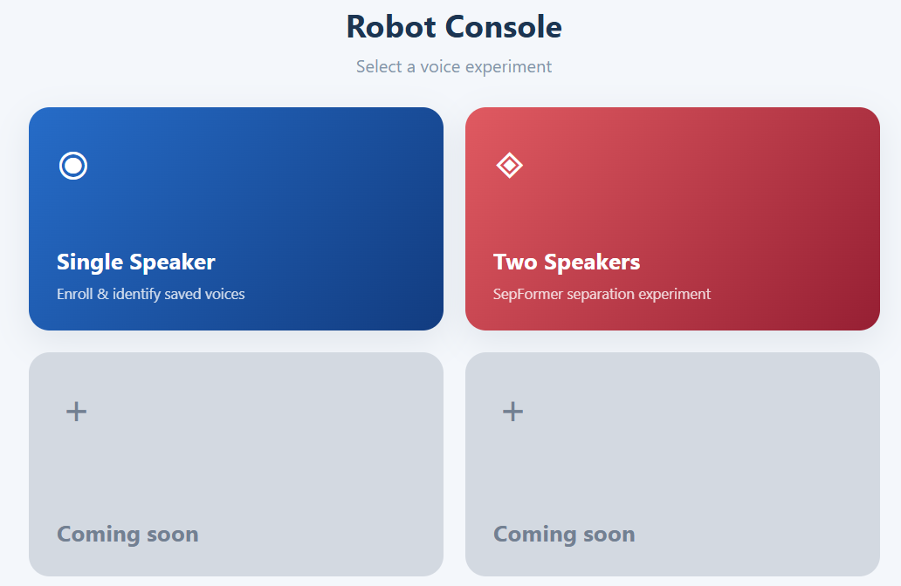
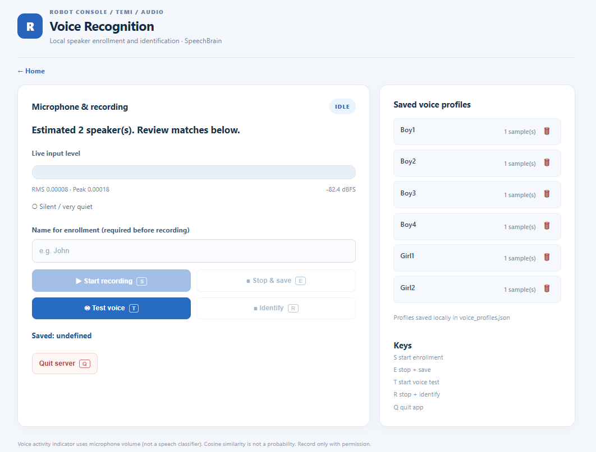
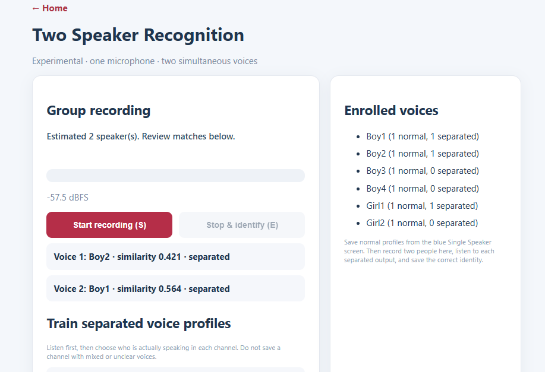

# Voice Lab 🎙️

A small voice recognition playground built with **Python, Flask, and SpeechBrain**.

## How it works
- **Single Speaker:** Record a voice, save a profile, and identify it later.
- **Two Speakers:** Use SepFormer to separate overlapping voices and match them to saved profiles.
- **Home:** Switch between experiments; more modes are planned.

## Why I'm building it
This is a prototype for a project I'm working on at work: helping a robot or smart speaker figure out **who's talking and who is addressing it**.

The long-term goal is to combine **voice profiles, spoken words, and other factors still being explored** to decide who to respond to.

**Work in progress** — more implementations and experiments coming soon.

---

---

---

